# Session B notes: trackers and Client relations (13 October 2026)

Branch `claude/serene-babbage-xgqaus`, from `main` at `f17c4bf`. No migrations, nothing deployed or applied.

## 1. Latest update text on every tracker row

- `updateLine(u, now, owner)` in `lib/tracker.ts` gives the stamp and then what changed:
  "Today 14:05 · Morag Reid · Invoice recorded". `mobile/src/Tracker.tsx` uses it for the phone card,
  the table's Last update column (now 240 wide, two lines) and the detail sheet. Screen readers get the
  same line in each row's label.
- Owners get the stamp only ("Today 14:05 · Recharge"): no staff name and no step name. That was
  already the rule in the detail sheet, and it is now one function. The database already sends owners
  no `updatedBy` or `updatedEvent` (migration `20261012070000`); the adapters also strip `by`.
- Question for the client: owners could see the fixed status words some adapters set (statements
  "Issued" or "Paid", AirCover "Marked as paid"). They are not names. To allow them, return
  `what` for owners in `updateLine` when it came from those adapters.

## 2. Direct-booking next action

- Cause: the next action was the first form the person could use. With the discount policy not yet
  confirmed, "Prepare a direct-booking offer" is unavailable (`gateDiscountPolicy`), so the first usable
  form was `recordGuestDecline`, titled "The guest said no". Every open follow-up read as a refusal.
- Fix (`lib/tracker-direct-bookings.ts`): each phase names the one form that moves it on
  (`prepareQuote`, `recordGuestAcceptance`, `confirmBooking`). That form is the next action. When it is
  unavailable the row shows the reason ("The discount policy awaits confirmation."), otherwise
  "Waiting for Guest relations" or "Waiting for Accounts". "The guest said no" is still offered as a
  button in the detail sheet.
- Wording for a declined follow-up: next step "Closed, the guest declined the offer"; the step's
  detail "The guest declined the offer".

## 3. Guest relations routine and the "Stays" labels

- `StaysRoutineCard.tsx` takes `part`. Guest relations (`part="guests"`) shows repairs to refer, cleans,
  AirCover and direct-booking offers. Client relations (`part="clients"`, new, above the chips in
  `ClientRelations.tsx`) shows listing checks, empty nights to price and the Monday owner reports. The card
  passes `TodaysRoutine` only that part's tools, so `StaysRoutine.tsx` is unchanged.
- The Monday "Weekly performance reports" item (sending owners their report) moved to Client relations
  in its own commit ("Routine: Monday owner reports in Client relations"), so it can be reverted alone if
  the client says no.
- "Stays" changed to "Guest relations" where users see it: "Waiting for Guest relations" in onboarding,
  enquiries, licensing and preventative visits, "Waiting for Guest relations to sign off", and the
  missed-checks approval row "Guest relations team". These are the team's name (the `stays` role). The
  listings adapter already said "Guest relations". "Stays still to reconcile" in statements means guest
  stays, not the team, so it was left.

## Tests

- New: `updateLine` (`tests/tracker.test.mjs`), the next action and the declined wording
  (`tests/tracker-guest-relations.test.mjs`), and a source check that the routine parts are split.
- Updated for the new wording: `tests/tracker-onboarding.test.mjs`, `tests/tracker-sections.test.mjs`
  and `tests/maintenance-forms.test.mjs` ("Waiting for Stays" became "Waiting for Guest relations").
- Ran every non-database test that mentions trackers or these screens (20 files): 250 of 254 pass.
  The 4 failures also fail on `main` without these changes. Each one checks for CRLF line endings,
  and this Linux checkout has LF files:
  - `wiring-v2` "the files this change touched have no em dashes and keep their line endings"
  - `tracker-guest-relations` "none of the new files contains an em dash ... CRLF"
  - `payables-screens` "the screens are wired ..." (AccountsPayable keeps CRLF line endings)
  - `statements-screens` "house rules ... CRLF source" (AccountsStatements has a lone LF)
- `npx tsc --noEmit -p mobile/tsconfig.json` passes with no errors (after `npm ci` in `mobile/`). The
  root `tsconfig.json` has 5 errors, all about the missing `remotion` packages in `landing/`. They are
  the same on `main`. ESLint is clean on the changed files.

## Waiting for the client's answers

- **Direct-booking cutoff** (exactly seven nights, or more than seven): both answers are ready in section 6.
- **Public enquiries creating a property immediately**: the proposal is in section 5, waiting for Lee.

# Round 2 (13 October 2026)

Changes to files outside my original list: `lib/regions.ts` (the region rules) and
`tests/property-region-database.test.mjs` (its tests). Both were needed for the region fix.

## 4. Region data: Dunbartonshire filed as East Lothian

**Cause (confirmed).** A property's region comes from `normaliseRegion` in `lib/regions.ts` (app) and its twin
`private.workspace_infer_region` (database, migration `20261010140000`). The database trigger fills a blank
region when a property is saved or imported and never replaces a set one. The postcode lookup
(`regionForCouncil` in `lib/postcode-lookup.ts`) uses the same app function on the council name. Both took the
first rule in a fixed list that matched anywhere in the text, inside words too. East Lothian's `dunbar` is
inside "Dunbartonshire", and East Lothian came first, so "West Dunbartonshire Council" read East Lothian.
The same kind of clash existed for Innerleithen (`leith`, Edinburgh). Street names also beat towns:
"Huntly Terrace, Paisley" read Aberdeenshire and Moray, and "Edinburgh Rd, Glasgow" read Edinburgh.

**Fix** (`lib/regions.ts`, migration `20261014200000_region_whole_words.sql`, not applied anywhere):
- The names live in one list, `REGION_RULES`: per area, council and county names (`councils`: "West
  Dunbartonshire" matches `dunbartonshire`, also "Perthshire", "Clackmannanshire", "Na h-Eileanan Siar") and
  towns and other places (`places`).
- Every name matches as whole words only.
- A council name wins over any place. Among names of the same kind, the one furthest to the right wins,
  because an address runs street, town, council. At the same spot the longer name wins, then the earlier area.
- The migration replaces only `workspace_infer_region`. Its name lists are generated from `REGION_RULES`, and a
  test fails if they ever differ. It changes no stored region.

**Tests** (`tests/property-region-database.test.mjs`, each address checked in the app and the database):
- the reported address shape, both Dunbartonshire councils, and Dunbar itself (still East Lothian);
- 49 real Scottish addresses (public buildings and landmarks), at least one for each of the 21 areas;
- 10 street-name clashes ("Huntly Terrace, Paisley", "Glasgow Road, Dumbarton", "Moray Place, Edinburgh");
- every name in the rules and all 32 council names;
- the migration's name lists equal the app's.

The new tests fail on the old rules and pass on the new. The region-related test files pass (9 files, 69 tests).

**Listing the affected properties.** I wrote no repair UPDATE. Once the migration is applied, this query lists
every property whose stored region differs from what its address now gives:

```sql
select id, name, status, region as stored_region, private.workspace_infer_region(address) as from_address
from public.workspace_properties
where private.workspace_infer_region(address) <> ''
  and region is distinct from private.workspace_infer_region(address)
order by name;
```

I ran the same comparison read-only on 13 October, with the new rule written inline because the migration is
not applied. It covered all 101 live properties and wrote nothing. Four disagree. Each one is the new rule being
right (I checked the addresses). Street addresses are left out here on purpose, so no live records are in the
repository:

| Property id | Name | Stored region | From its address | Why |
| --- | --- | --- | --- | --- |
| `292802c6-13ad-4b01-865a-d6f6b69b0369` | 416 Main | East Lothian | Dunbartonshire | West Dunbartonshire Council, G83 (the reported one) |
| `1946216c-40da-4b10-a4b8-77fa0cfc178d` | Townend v2 | East Lothian | Dunbartonshire | Dumbarton G82, West Dunbartonshire |
| `de9b3438-33e1-4d57-8ab3-ffe4ecda03e3` | 329 Edinburgh | Edinburgh | Glasgow | Edinburgh Rd, Glasgow G33 (street name won) |
| `88f090fa-87eb-4b57-8724-663596c8a840` | 9 Iona v2 | Inverness and Highlands | Fife | Skye Rd, Dunfermline KY11, Fife (street name won) |

- **Repair:** Lee to approve. The migration will not move them, because the trigger never replaces a set
  region. Each can be corrected in the app, or with one approved UPDATE written then.
- **Huntly rows:** "65 Huntly" and "80 Huntly" were typed correctly. Under the old rule their addresses read
  Aberdeenshire and Moray; the new rule agrees with what is stored.
- **"5 Eden":** stored Aberdeen. The address names both Peterhead and Aberdeen, and the new rule now agrees
  with what is stored.

## 5. Proposal: every new enquiry in Properties straight away (design only, not built)

Today a landlord's answers wait as *New: ready to value*. **Start valuing** (`startValuing`) runs `createEnquiry`
as the staff member, which creates the property, the onboarding journey (stage `enquiry`) and the "Property
onboarding" work item. The proposal: do the same when the landlord submits the form.

**What submit creates** (`workspace_enquiry_public`, action `submit`, runs with the service key, no signed-in user):
- **Property:** `workspace_properties` with `status = 'onboarding'`. The name is the first line of the
  property address (as `lib/client-enquiry.ts` already drafts it), plus the address and bedrooms. The region
  is left blank, so the trigger fills it from the address. `created_by` is the staff member who sent the link
  (`sent_by`).
- **Journey and work item:** `workspace_journeys` at stage `enquiry` with `client_id` null, holding the
  property type, bathrooms and answers. The "Property onboarding" work item as today.
- **Enquiry link:** the enquiry keeps status `received` and gains `property_id`.

**Status shown:** "Onboarding", stage "New enquiry". There is no new property status: the check constraint
allows onboarding, active and archived, and every screen already reads stage `enquiry` that way.

**Who owns an unvalued property:** no owner. There is no `client` assignment and the form never creates an
account. The landlord is linked later through the usual owner assignment, once they have an account. The
sender gets a `staff` assignment when they are Guest relations, as `createEnquiry` does today.

**Spam and duplicates:**
- **Spam:** the form only works through a private link the team sent: one link, one submit (the status must be
  "sent" or "opened"), and the link expires after 30 days. So spam needs a leaked link and can create at most
  one property per link.
- **Duplicates:** if the address matches an existing property, after case, spacing and postcode tidying, or the
  landlord answered "existing client: yes", the property is still created, but the enquiry is marked
  "possible duplicate" with the other property's id. The team then closes one; nothing is merged
  automatically.
- **Closing:** closing or declining the enquiry archives its property and cancels the work item, only while the
  journey is at stage `enquiry`. Nothing is deleted.

**PropertiesTable and OnboardingTracker:**
- **PropertiesTable:** shows the row at once, with status "Onboarding", stage "New enquiry", the region from
  the address, and last update = the submit time, shown as "Recharge" to owners.
- **Portfolio summary:** counts it under onboarding (`portfolioSummary` counts everything not archived).
  Open question: should unvalued enquiries count there, and on the map?
- **OnboardingTracker:** shows it as a property in the *New enquiry* group. It already drops an enquiry row
  once the enquiry has a property (`onboardingTrackerItems`), so nothing is listed twice. Start valuing becomes
  "Check the details and value": the team corrects the name, address and region on the property, then values
  it as now.

**Privacy:**
- Owners never see these properties. Nor do cleaners, Ready or Accounts: they have no assignment, and there
  are no stays or cleans.
- The landlord's contact details stay on the enquiry, read only by people with enquiry access
  (`workspace_can_enquiries`). They are not copied onto the property.
- The public submit returns nothing about the property.
- Files stay in the private `enquiry-files` bucket.

**Migration outline:** one file, `20261014210000_enquiry_property_on_submit.sql`, anchor and append, safe to
run twice:
1. New `private.workspace_enquiry_create_property(e private.workspace_client_enquiries)`, security definer, no
   grants. It inserts the same rows as `createEnquiry`, without its signed-in role checks, and runs the
   duplicate check.
2. Patch the `submit` branch of `workspace_enquiry_public`: call (1) after the `set status='received'` update.
   The `enquiry.received` activity carries the property id.
3. Patch `workspace_client_enquiry_action`. `startValuing` reuses the existing property and applies the team's
   corrections instead of creating another one. `closeEnquiry` archives the property while the journey is at
   stage `enquiry`.
4. New column `possible_duplicate_of uuid` on `private.workspace_client_enquiries`, shown in the enquiry view.
5. No backfill, unless Lee wants enquiries already received converted.
6. App: `LiveEnquiries.tsx` gets the new button wording and the duplicate badge.
7. Test: `tests/enquiry-property-database.test.mjs`. It checks one property per submit, with no owner, and
   who can read it; the duplicate flag; startValuing reuse; close archives; a second submit is refused.

**Decisions for Lee or Alex:**
- (a) status `onboarding` at stage `enquiry` (recommended);
- (b) count unvalued enquiries in the portfolio summary and the map, or not;
- (c) give the sender a staff assignment;
- (d) archive on close (recommended), or delete;
- (e) convert enquiries already received.

## 6. Direct-booking cutoff: ready for Alex's answer (not applied)

Today a confirmed booking-site stay of `check_out - check_in >= minimum_nights` gets a follow-up, and the
setting is 7, so **exactly seven nights qualifies**. If Alex says "seven or more", nothing changes.

If Alex says **"more than seven"**, there are two ways to do it:

- **A. Change the setting to 8 (recommended).** No code and no migration. A super admin opens the
  direct-booking policy form in the app ("Minimum nights for an offer", action `configureBookingPolicy`) and
  enters 8. The equivalent one line, for the record only (the app is the right place, because it keeps the
  version and the activity log):
  `update private.workspace_booking_policy set minimum_nights = 8, version = version + 1 where singleton;`
  Everything that reads the setting follows at once: the six-hourly sweep (`workspace_direct_booking_sweep`),
  `recordReservation`, the Hostaway import (`workspace_import_reservation`), the reservation-change path
  (`workspace_controls_action`), the offer's own night check in `prepareQuote` (`not between
  policy.minimum_nights and …`) and the record-a-stay hint. `StaySheet.tsx` reads `minimumNights` from the
  policy, so the hint becomes "8 nights. Stays of 8 nights or more get a direct-booking follow-up for the
  team." This is correct, and no wording change is needed. Watch out: the same form also holds the
  discount-policy "confirmed" tick, so leave it as it is when saving.
- **B. Change `>=` to `>`** in a migration in my range. This is not one line. The comparison is in four
  database functions (`workspace_operations_action` twice, for `recordReservation` and for `prepareQuote`'s
  `not between`; `workspace_import_reservation`; `workspace_controls_action`; `workspace_direct_booking_sweep`),
  each patched by anchor. Then in `StaySheet.tsx` (outside my files): `nights >= minimumNights` becomes
  `nights > minimumNights`, and the hint becomes "Stays of more than ${minimumNights} nights get a
  direct-booking follow-up for the team." The setting label "Minimum nights for an offer" would then be
  wrong and would need renaming too.

**Recommendation: A.** It is one value, consistent everywhere, takes effect immediately and can be undone the
same way.

**Either way:** follow-ups already open for stays of exactly seven nights stay open. The team can close them;
this read-only query lists them:
`select w.id, w.title from public.workspace_work_items w join private.workspace_domain_details d on d.work_id = w.id join private.workspace_reservations r on r.id::text = d.data->>'reservationId' where d.kind = 'direct_booking' and w.status not in ('completed','cancelled') and r.check_out - r.check_in = 7;`

# Round 5 (15 October 2026): every new enquiry in Properties straight away (built)

Lee approved section 5. Built on `claude/serene-babbage-xgqaus` after merging the lead branch
(`claude/fervent-brahmagupta-8qd03b`, fast-forward to `5a113a3`). One migration:
`20261015200000_enquiry_property_on_submit.sql`. Not applied anywhere.

## What happens now

- **Submit** (`workspace_enquiry_public`, action `submit`). In the same transaction as the answers, it creates:
  - the property: status onboarding, named from the first line of the address by the same rule as
    `valuationDraft`, region from the address, `created_by` = the sender;
  - the journey: stage `enquiry`, no owner, and only the property's facts (WCs, parking, garden, photo link,
    existing client);
  - the "Property onboarding" work item, `created_by` = the sender.

  The landlord's name, email, phone, correspondence address and notes stay on the enquiry. One submit per
  link and the 30-day expiry are unchanged.
- **Onboarding team:** the journey's existing insert trigger gives Guest relations staff with property
  onboarding their usual assignment. Nobody is signed in during a public submit, so the trigger now falls
  back to the work item's creator (the sender) for `granted_by`.
- **Duplicates.** Flagged, never merged, using two new columns on the enquiry:
  - `duplicate_of` is another property in use at the same address (case, punctuation, spacing, the
    postcode's space and a trailing UK or Scotland are ignored);
  - `duplicate_reason` is `same_address`, or `existing_client` when the landlord said they already work with
    us.
- **Start valuing** reuses the property. The team's corrections (name, address, region, type, rooms,
  enquiry details) are saved onto it and no second property is made. If an estimate was already published
  from the property, its details are left as they are. Enquiries answered before the migration have no
  property and keep the old path.
- **Closing** an enquiry whose property is still at the enquiry stage archives the journey and the property,
  and marks the work item declined, as for any archived journey (`workspace_onboarding_status_guard` allows
  nothing else, and still refuses every other change). Nothing is deleted. A property that has moved on is left alone.
- **Privacy.**
  - Owners, cleaners, the cleaning manager and Ready have no assignment, so they never see it.
  - Accounts could read every property (the table policy and `workspace_can_property`). Both now leave out
    a property whose journey is still at stage `enquiry`. **This also hides enquiries the team adds by
    hand from Accounts until they are valued**, which matches the rule; flagging it in case Accounts relied
    on it.
  - The `enquiry.received` notice is unchanged. Giving it a property would change who reads it under
    `activity_scoped`, so `activity_scoped` and `workspace_activity` are untouched.
- **App:**
  - `LiveEnquiries.tsx`: the button reads "Check the details and value" when the property already exists
    ("Start valuing" for older enquiries); a "Possible duplicate" badge on the row with a note in the sheet;
    an "Open" link to the property; the close sheet says the property is archived too.
  - `lib/tracker-onboarding.ts`: one row per property; the journey row carries "From: the enquiry form" and
    the duplicate flag, for staff only.
  - `lib/property-table.ts`: the Properties table shows the stage "New enquiry".
  - `lib/client-enquiry.ts`: the new fields, with defaults so older reads still parse. Once the property
    moves on, the enquiry's step follows the property.

## Existing answered enquiries (no backfill, for Lee to decide)

Enquiries answered before this migration and not yet valued keep today's flow: their property is made when
someone presses Start valuing. To list them (not run; no contact details selected):

```sql
select e.id, e.status, e.submitted_at, e.sent_by
from private.workspace_client_enquiries e
where e.status = 'received' and e.property_id is null
order by e.submitted_at;
```

If Lee wants them converted, one more migration in my range can call
`private.workspace_enquiry_create_property(id)` for each of them.

## Files outside my original list

- `lib/client-enquiry.ts`: the enquiry schema and step.
- New test files: `tests/enquiry-property-database.test.mjs` and `tests/enquiry-property.test.mjs`.

## Tests

- **App side:** `tests/enquiry-property.test.mjs`, 6 of 6 pass.
- **Related non-database tests:** tracker-onboarding, property-table, enquiry-and-preview, tracker-sections,
  navigation-v2 and wiring-v2: 87 of 88 pass. The 1 failure is the known CRLF check in `wiring-v2`.
- **Types and lint:** `npx tsc --noEmit -p mobile/tsconfig.json` passes. ESLint on the changed files is
  clean apart from an unused `web` import in `LiveEnquiries.tsx` that was already on `main`.
- **Database tests:** `tests/enquiry-property-database.test.mjs` covers create, privacy per role,
  duplicates, Start valuing reuse, closing, older enquiries, and running twice. It and the existing
  `tests/client-enquiries-database.test.mjs` have **not been run yet**: running database tests was blocked
  by this session's permission check midway through this round. See the open points.

## Open points

1. **Database tests.** The Lead ran them on `c2a8bbc`: 11 of 13 passed, including all of
   `client-enquiries-database`. Both failures are now fixed:
   - Closing tried to set the onboarding work item to "cancelled". `workspace_onboarding_status_guard`
     allows only "declined" once a journey is archived, so it is now set to "declined", the journey's own
     rule. The test also checks that the guard still refuses cancelled, completed and declined from anyone
     else.
   - The "runs twice" test passed the whole migration to `db.query`. It now uses `db.exec`.

   Every patch anchor is a single line, so the migration does not depend on line endings: `.gitattributes`
   checks SQL out as CRLF, and the live functions may have been created from LF text.
2. **Lee:** convert the enquiries answered before this change, or not (query above).
3. **Lee:** should unvalued enquiries count in the portfolio summary and on the map? They currently do, as
   onboarding.

## Tell the team

- Accounts no longer see a property while it is at the enquiry stage, including one the team adds by hand
  before valuing it. It appears for them as soon as it is valued (estimate stage onwards).
- Every answered enquiry form is now in Properties straight away, as "Onboarding · New enquiry". Closing
  the enquiry archives that property.
- "Possible duplicate" on an enquiry means: check the other property and close one if it is the same place.
  Nothing is merged automatically.

# Round 5, second task: menu order per role (Lee's request)

Built on `claude/serene-babbage-xgqaus` after merging `main` (`b25d02f`). One migration:
`20261015210000_menu_layouts.sql`. Not applied anywhere. For this round Session B owns the navigation.

## What it does

- **Access control → Menu order** (super admins only; a new People / Menu order switch at the top of
  Access control, in `mobile/src/MenuOrderEditor.tsx`):
  - pick a role (Super admin, Admin, Guest relations, Cleaning manager, Cleaner, Ready, Accounts, Owner);
  - move its sections up or down, and the links inside each section up or down;
  - press **Save and publish**. **Undo changes** and **Reset this role to default** are there too, with
    "Last changed by X on ...".

  The move buttons are plain 44-point buttons with labels such as "Move section Overview up", so they work
  on a phone, with a keyboard and with a screen reader. There is no drag.
- **Live preview:** it shows the phone bar, the left panel and the phone menu's sections for that role. It
  is built by the same code the app uses (`rolePanel` with the layout, then `orderPhoneBar`), with the
  role's usual tools.
- **Arrange only, never grant.** `lib/menu-layout.ts` (`applyMenuLayout`):
  - it starts from the sections and links the role and its tools allow, then applies the saved layout;
  - **links can move between sections** (Lee's answer): each section lists its links in order, and a link
    belongs to the section that lists it. If a layout lists a link under two sections, the first wins:
    sections in the saved order first, then any other listed sections;
  - a link the layout does not list (for example a tool added later) goes back to its default section,
    after the listed ones, in its default order;
  - unknown keys, keys the role does not have, sections the role does not have, and repeats are ignored;
  - a section left with no links is hidden in the app. The editor keeps it ("Empty: hidden for this role
    until a link is moved here"), so links can be moved back.
- **Move to section:** every link in the editor has a "Move to…" button. It opens a row of plain buttons,
  one per other section, and the link goes to the end of the chosen section. Move up and Move down work as
  before.
- **Stable keys:**
  - each section now has a key in `lib/role-panel.ts` (`overview`, `departments`, `calendar-messages`,
    `management`, `more`, `start`, `today`, `work`, `guests-listings`, `my-day`, `my-work`, `me`,
    `cleaning-team`, `cleaning-desk`, `jobs`, `ready-desk`, `accounts`, `money`, `costs`,
    `your-properties`, `requests`);
  - links use their existing keys (`page:home`, `area:stays`, `tool:payouts`...);
  - renaming a section title keeps its key.
- **Desktop and phone use the same merged menu** (`mobile/src/LiveWorkspace.tsx`):
  - **Desktop:** the left panel is `rolePanel(role, modules, layout)`.
  - **Phone bar:** the same destinations as today, reordered by where they come in the merged menu (Work
    counts as the first Work area). So the first sections fill the bar.
  - **Phone menu:** there was no More menu on phones. A new **Menu** button in the phone header opens a
    sheet with every section in order, without the places already on the bar.
  - **Work tabs:** the phone's Work area tabs follow the order of the areas too. Which area opens first does
    not change.
- **View as:**
  - **a person:** the reads run as that person, so the menu shown is their role's;
  - **a role preview** (no person): the app takes that role's layout from the super admin's list of every
    role;
  - **Demo mode:** uses the default order.
- **Publishing:**
  - after Save, the editor's own app updates at once, through `mobile/src/MenuLayoutStore.ts`, when the
    saved role is the editor's own;
  - everyone else gets it on the existing one-minute quiet refresh, or when they reopen the app;
  - the read is one small row.

## Database (`20261015210000_menu_layouts.sql`)

- `private.workspace_menu_layouts`: one row per role (`sections` array, `items` object of arrays, `version`,
  `updated_by`, `updated_at`). Empty arrays mean the default order.
- Team read `menuLayout`: anyone signed in gets **their own role's** layout, order data only (role,
  sections, items, version).
- Team read `menuLayouts`: super admins get every role's layout, with who changed it and when.
- Team actions `saveMenuLayout` and `resetMenuLayout`:
  - super admins only;
  - optimistic version check (version 0 is a role never changed);
  - keys must be stable keys (lower case, digits, `: _ = -`), each once, at most 40 sections and 80 links
    per section;
  - a retried request gets the same answer (action receipts).
- Every save or reset writes `workspace_access_events` (`menu_order_saved` / `menu_order_reset`). The person
  and the actor are both the super admin, the old order is in `old_access`, and the role and new order are in
  `new_access`. Access control's history shows "Menu order saved · Guest relations".
- Routes are appended after the hub anchors in `workspace_teams_read` and `workspace_teams_action`. They
  are single-line anchors with sentinels, so the migration is safe to run twice.
- Schemas: `lib/workspace-teams-policy.ts` gained the two read sections and the two actions (at the end
  of their lists).

## Tests

- `tests/menu-layout.test.mjs`, 13 of 13 pass:
  - the merge never adds a tool the role lacks and never loses one, and lists each link once;
  - a link moved between sections shows there on desktop, on the phone bar and in the phone menu;
  - a link listed twice stays in the first section;
  - an emptied section is hidden in the app and kept in the editor;
  - a moved link disappears when the role loses its tool, and a new tool appears in its default section;
  - saved order applied;
  - unknown and duplicate keys ignored;
  - new tools fall in at their default place;
  - the desktop panel, phone bar, phone menu and Work tabs agree;
  - the editor's moves, and the preview equals what the role gets;
  - request schemas;
  - wiring.
- `tests/menu-layout-database.test.mjs`, 5 of 5 pass:
  - own-role read only, order data only;
  - only super admins can save or reset (admin, staff and owners refused);
  - version check;
  - keys checked;
  - access history and retry;
  - the migration runs twice.
- Database tests that share the patched team routes, plus the two enquiry ones: management-flags,
  enquiry-property, client-enquiries, team-calendar, aircover-links, day-reflection, daily-tasks,
  access-control. 67 of 67 pass.
- Whole non-database suite: 849 of 861. The 12 failures fail on `main` too:
  - 5 are line-ending checks: this checkout's files predate the new `.gitattributes` and are LF;
  - 7 need build output (prepared Worker, preview, hosted routes, icon fonts, Cloudflare redirect).
- `npx tsc --noEmit -p mobile/tsconfig.json`: no errors. ESLint: no errors on the changed files.

## Decisions (Lee and the Lead, 13 October)

1. Links can move between sections: Lee said yes, and it is built (`128e016`).
2. Phone bar: decided by the Lead. It stays as built: the bar follows the section order, and the Menu
   button sits in the phone header. There is no editor control for the bar this round. Lee can change this
   later.
3. Home tools: decided by the Lead. They keep their own order this round. Lee can change this later.
4. Section titles: decided by the Lead. They cannot be renamed in the editor. Lee can change this later.

# Round 5, third task: the property and person picker is search only (Lee)

Lee: "don't add property names just make it searchable, the less buttons the less confusion."

## What changed

- **One picker:** `mobile/src/SearchPicker.tsx` (`SearchPicker`, `PropertySelect`). It is used in 28 places.
  The rule is in `lib/search-picker.ts` (`pickerView`). Matching (`lib/search-options.ts`) is unchanged.
- **Long lists (more than 8 options):**
  - **before anything is typed:** only the search box, the fixed options ("Every property", "All
    properties", "Not sure yet", "Me") and the current choice as one selected chip (with `clearable`,
    tapping it clears the choice). When nothing is chosen, a line says "Nothing chosen yet. Type to find
    one of the 101 properties.";
  - **once something is typed:** the best matches (up to 12) as before, the current choice kept first,
    "Showing x of y properties. Keep typing to narrow it down." when there are more, and "Nothing matches
    ..." when there are none.
- **Short lists (8 or fewer):** unchanged. Every option is a chip, with no search box.
- **Placeholder:** `PropertySelect` now reads "Search for a property by name, street or postcode".

## Every screen that uses it

- **A choice is needed, and the button waits for it:** Create clean (`LiveCleans.tsx`, the button is
  disabled until a property is chosen) and Check figures in Statements (`AccountsStatements.tsx`, disabled
  with "Choose a property to check its figures"). Both are fine.
- **A choice is needed, but the button only checks when pressed** (an error names the property): Record a
  stay (`StaySheet.tsx`), Report a repair and New routine plan (`LiveRepairs.tsx`), and Supplier invoice
  (`AccountsPayable.tsx`). They still work, and the picker now says "Nothing chosen yet". **Suggested
  follow-up (not done; these files are not mine this round):** disable each Save until a property is
  chosen, as Create clean does.
- **The first property is already chosen:** Restock requests (`LiveTools.tsx`). Fine.
- **Choosing acts at once (the picker always starts empty):** Give someone a property (`LivePeople.tsx`,
  type, then tap to assign), Find a person (`LivePeople.tsx`) and New to-do's property step
  (`HubItemSheet.tsx`). Fine: type, tap, done.
- **Filters with a fixed option:** Checklist templates (Every property), Calendar property and person
  filters (All properties / everyone), Guest inbox property (Not sure yet), Team events (Me). Fine.
- **Optional, clearable:** Receivable (stay, property, client), Performance filter, Cleaner invoices
  property filter, Messages property, To-do property, Team time owner and backup. Fine.
- **People pickers that are usually short:** Assign a cleaner (`LiveCleans.tsx`, only the cleaners who can
  take that clean), To-do assignee, Team time person. Unchanged while 8 or fewer.
- **Feels wrong: the Messages property filter in the guest inbox** (`InboxChips.tsx`). Its chips carried a
  count per property ("Leith flat (3)"), so the team could see where messages were waiting. On a long
  list those counts are now hidden until something is typed. Lee to decide: keep it search only, or show
  the properties with waiting messages there. Not special-cased.
- `LiveHub.tsx` also uses it, but that screen is retired and not routed.

## Tests

- `tests/search-picker.test.mjs`, 5 of 5 pass:
  - no chips before typing on a long list;
  - fixed options and the current choice still shown;
  - matches (the same as `searchOptions`) appear when typing, with the count and the no-match state;
  - short lists unchanged;
  - the component uses the view.
- `tests/search-and-cancel.test.mjs`, 7 of 7 pass (matching unchanged).

## Lee's four acceptance screens: before and after

All four use the shared picker (`AccountsStatements.tsx` line 298, `AccountsReceivable.tsx` line 66,
`AccountsPerformance.tsx` line 102, and `HubItemSheet.tsx` for AirCover's "Add a claim"), so the change
covers them. None shows a chip before typing now.

**How the shots were taken:** these screens only render with a signed-in backend. So a temporary route
(not committed) rendered the real `SearchPicker` / `PropertySelect` with each screen's own props (empty
text, `clearable`, placeholder, nouns). It used made-up data of the reported size, 101 properties and 332
stays, and Playwright took the shots in Chromium.
- **Before:** the picker as it was at `128e016`.
- **After:** the current picker. A third shot for each screen shows it after typing.
- The surrounding screens are not in the shots.

| Screen | Before | After | After typing |
| --- | --- | --- | --- |
| Statements → Prepare a statement → Property | 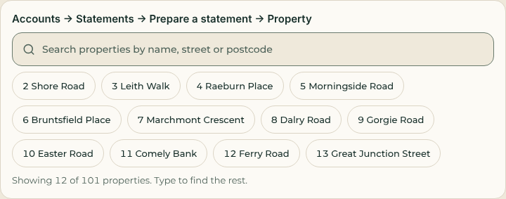 | 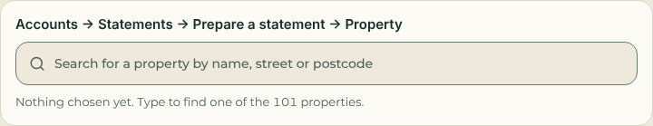 | 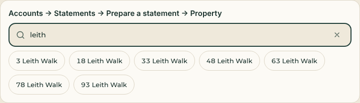 |
| Receivable → Record invoice → Guest stay | 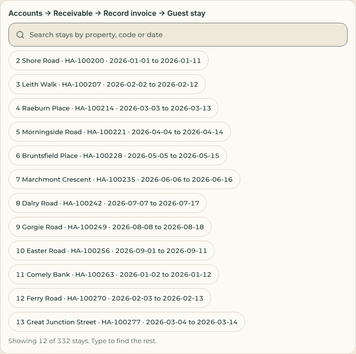 | 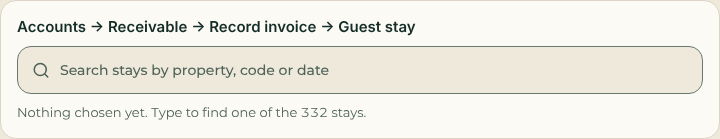 | 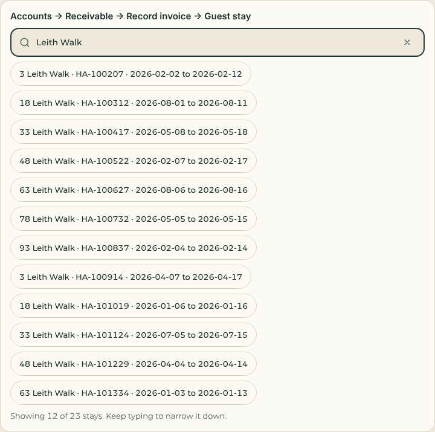 |
| Performance → Filters → Property | 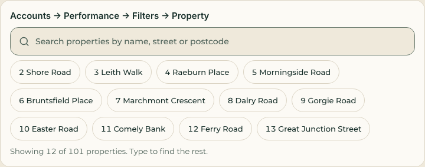 | 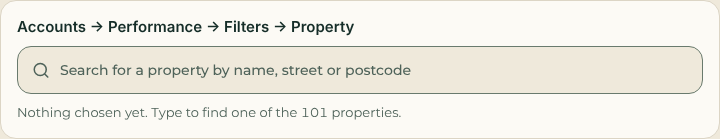 | 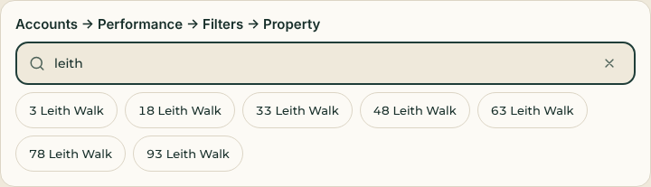 |
| AirCover → Add a claim → Property | 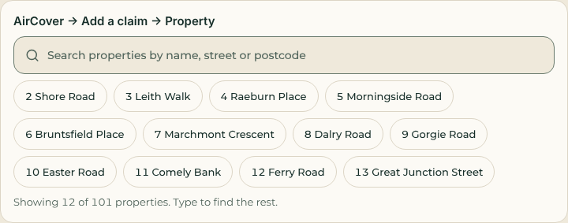 | 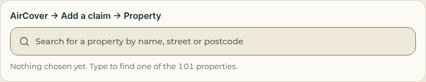 | 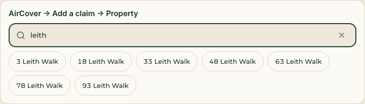 |

Before, each showed 12 chips, with property names, or for stays the property, HA code and dates, plus
"Showing 12 of 101 properties" or "Showing 12 of 332 stays". After: the search box and "Nothing chosen yet.
Type to find one of the ...". Typing shows up to 12 matches with "Showing x of y. Keep typing to narrow it
down."

## Follow-up: Save waits for a property

- **Where:** Record a stay (`StaySheet.tsx`), Report a repair and New routine plan (`LiveRepairs.tsx`), and
  Supplier invoice (`AccountsPayable.tsx`, edited for this change only).
- **What:** Save stays disabled until a property is chosen, and "Choose a property first." shows just above
  it while none is chosen. The rule is one helper, `saveDisabled(busy, propertyId)` with
  `CHOOSE_PROPERTY_FIRST`, in `lib/search-picker.ts`.
- **Unchanged:** each form's own check when saving, and the server's check.
- **Tests:** `tests/search-picker.test.mjs` checks the rule (disabled with no property or while saving,
  enabled once one is chosen) and, per screen, that the Save button uses it and the hint is shown. 11 of 11
  pass. The screens are checked from their source, because this repository has no React Native
  renderer for tests.
- **Guest inbox filter counts:** left as they are. Session C's Messages redesign removes that filter.

## Updates bell and pull to refresh (from Session C's Messages redesign, options 1 and 3)

- **Updates bell** in the header, on desktop and the phone, for every role, beside Messages:
  - its badge is the number of unread notices (`updatesBell` in `lib/header-actions.ts`, using
    `unreadNotices`, "99+" past 99);
  - it opens the Updates feed with `navigate("activity")`: the team land on Messages showing the feed, and
    owners land on their Updates page;
  - its screen-reader label is "Updates, 3 unread";
  - `LiveChat.tsx` is unchanged;
  - in a role preview (View as a role), the super admin's notices are not kept, so the badge stays empty.
- **Pull to refresh** on the phone: a `RefreshControl` on the workspace's page `ScrollView` runs the same
  quiet refresh as the one-minute timer (`refresh(true)`). Not on desktop.
- **Tests:** `tests/header-actions.test.mjs`, 4 of 4 pass:
  - the count, badge and label, the same for every role;
  - the bell is in the header with no role or screen-size condition, with its badge;
  - it opens the Updates feed;
  - pull to refresh calls the quiet refresh.

  The header is checked from source; there is no React Native renderer for tests here.

# Round 6: the To-do page and the New to-do form (from Alex's video)

## 1. Updates on a to-do

- **Database** (`supabase/migrations/20261016200000_todo_updates.sql`, in the 20261016200000 to
  20261016299999 range):
  - New table `private.workspace_hub_item_updates`: the to-do, the text (1 to 2,000 characters), the kind
    (`note`, `done` or `reopened`), who wrote it and when.
  - RLS is on and signed-in users have no direct access; the write limit trigger applies.
  - New action `addTodoUpdate` `{ requestId, id, text }`, routed from `workspace_teams_action` after the hub
    route. It uses action receipts, so a repeated request returns the same answer.
- **Who can add updates:** anyone who can see the to-do, using the to-do's own rule
  (`private.workspace_hub_can_see`): the admin, the person it is for, the person who set it, or the
  department's team.
  - Owners are refused: the client role gets "Team access required", the same as the hub read.
  - A to-do the person cannot see reads "To-do not found".
  - Approvals, claims and invoices take no updates.
- **Who hears about an update:** the person it is for and the person who set it get a notice
  (`hub.todo_updated`). The writer does not.
- **Ticking:** ticking a to-do done logs "Marked done", and unticking it logs "Reopened" (`moveHubItem`).
- **The hub view:** for a to-do it now returns `updateCount` (the running total) and `updates`, the last
  100, newest first. Other kinds return 0 and `[]`.
- **Patches:** three anchor-and-append patches with sentinels: the hub view, the hub action and the teams
  route. All anchors are single lines, because of the CRLF checkout.
- **Run twice:** the table and indexes use "if not exists", the functions are replaced, and the patches
  have sentinels. A test runs the migration a second time and checks that nothing changes.
- **Not applied anywhere.** Lee or the Lead applies it.
- **App:** the `addTodoUpdate` schema is added at the end of the union in `lib/workspace-teams-policy.ts`.
  `lib/todo.ts` adds `todoUpdateSchema`, and `todoHubItemSchema` gains `updateCount` and `updates`, both
  defaulting to empty so older answers still parse. Each row now has `latest` and `updateCount`.
- **The detail** (`TodoDetailSheet` in `TodoList.tsx`) opens when a to-do row is clicked. It shows:
  - where, when and who;
  - Mark done or Reopen, and Edit (which opens the existing form);
  - "3 updates · Last update 2h ago by Dan Fraser";
  - the "Add update" box;
  - the full history, newest first. Each entry shows the text, the stamp ("Today 12:34 · Dan Fraser") and
    how long ago.

  Automatic tasks still open their work, as before.

## 2. New to-do form (`HubItemSheet.tsx`)

- **Who is it for** is now one `Dropdown` (Session A's `mobile/src/Dropdown.tsx`) with Me, A person and
  A department. "A person" shows a second dropdown, "Which person?", over the team; "A department" shows
  "Which department?". The chips are gone. Saving "A person" with no one chosen says "Choose the person."
- **The due date** (and "Send by" on an invoice) is Session A's `DateField` in single mode, in place of the
  typed YYYY-MM-DD box. "No date" removes it.
- **The property** stays the shared `PropertySelect`, which is search only on long lists since round 5.
- **For Session A:** in single mode, the empty `DateField` reads "Choose dates" (plural), from
  `rangeLabel`'s default. I did not change Session A's file.

## 3. Thin, spreadsheet-like rows

- **The table:** `ThinTable` in `mobile/src/Tracker.tsx`. It has one line per row, 40 px rows
  (`THIN_ROW`), a 32 px header in the wash colour, and it scrolls sideways when the columns are wider
  than the screen.
- **The trackers use it too:** `TrackerList` now draws `ThinTable` in place of `SheetTable`.
  - The tracker columns are unchanged, but each is now one line: the address with the title after it, the
    status with Flagged beside it, and so on.
  - So every tracker table (purchases, licensing, onboarding, accounts and the rest) has the same density.
    Phone cards are unchanged.
- **To-do on a computer** (from 1,024 px, `todoLayout`), with these columns:
  - tick;
  - property (the full address, or "–");
  - task (the title, with the description truncated on the same line);
  - latest update;
  - updated by;
  - when ("2h ago");
  - due ("Today", "12 Oct", red when overdue);
  - status (To do, Automatic or Done).

  The columns are in `TODO_COLUMNS` and what each shows is in `todoCells`. Clicking a row opens the
  detail.
- **The empty cell:** the brief asked for an em dash, but the To-do and Tracker files have a no-em-dash test. So empty
  cells use the "–" the sheet tables already use (`EMPTY_CELL` in `lib/tracker.ts`).
- **To-do on a phone:** a two-line card (`todoCardLines`). The first line is the task and the due day. The
  second is the property and the latest update (who and when), or the description when there is no
  update. The tick is a 44 px target.
- **Same rows everywhere:** the automatic sections, the four headings and the Done list all use these
  rows, and the Home summary card uses the phone card.
- **New in `lib/tracker.ts`:** `timeAgo`.

## 4. Pricing overload

- **Unchanged:** the automatic pricing rows are still made the same way, so all 180 are kept.
- **Change:** each heading now shows 10 rows (`ROWS_PER_HEADING`, was 8). The button reads "Show all N"
  (for example "Show all 185" under Client relations with 180 pricing rows), and "Show fewer" once open.

## Tests

- **`tests/todo-updates-database.test.mjs`** (PGlite, all migrations): 8 of 8 pass. It covers:
  - adding updates, newest first, with who and the running total;
  - visibility: own, department and admin; others get "To-do not found";
  - owners refused, with no table access;
  - "Marked done" and "Reopened", and nothing for approvals;
  - input checks and a repeated request;
  - notices;
  - running the migration twice.
- **`tests/todo-rows.test.mjs`**: 16 of 16 pass. It covers:
  - the log reaching the rows;
  - update kinds and the action schema;
  - `timeAgo`;
  - the column order and what each column shows;
  - the phone card;
  - phone versus desktop (1,023 px gives cards, 1,024 px the table);
  - "Last update X ago by Y";
  - the 180 pricing rows with "Show all 180";
  - the form's dropdowns and `DateField`;
  - the screens' table, cards, 44 px ticks and detail;
  - the tracker using the thin table;
  - no em dashes.

  The screens are checked from source, because there is no React Native renderer for tests here.
- **Existing tests still pass:** `todo`, `tracker`, `tracker-onboarding`, `hub-database`, `hub-policy`,
  `daily-tasks-notice-routes-database`, `wiring-fixes-v2`, `management-approvals` and `search-picker`
  (98 of 98).
- **No test file outside my area was changed.**
- **Checks:** mobile TypeScript (`npx tsc --noEmit -p mobile/tsconfig.json`) and ESLint on the changed
  files are clean.

## Screenshots (sample data)

**How they were taken:** a temporary route (not committed) rendered the real `TodoList` from sample data.
The sample has 180 properties, 180 pricing gaps, 3 listing checks due and 10 hub to-dos with updates, for
a Stays persona. The hub read came through the app's demo answers. Playwright took the shots in Chromium.

| Desktop | Desktop, detail | Desktop, New to-do |
| --- | --- | --- |
| 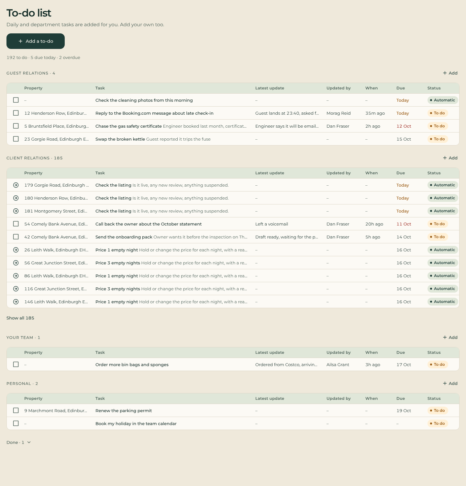 | 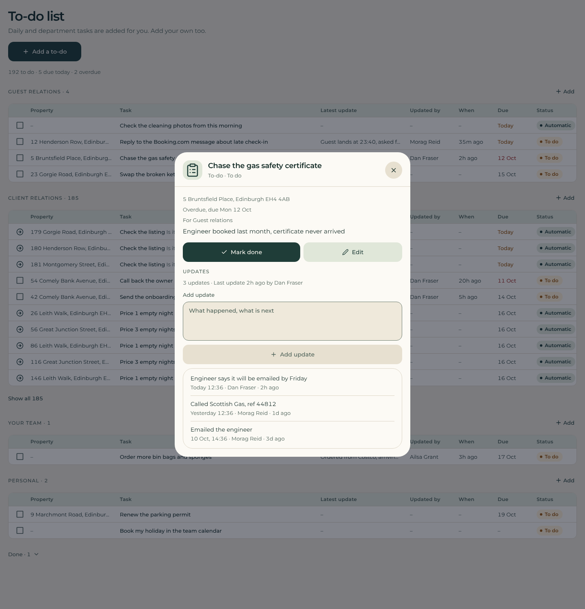 | 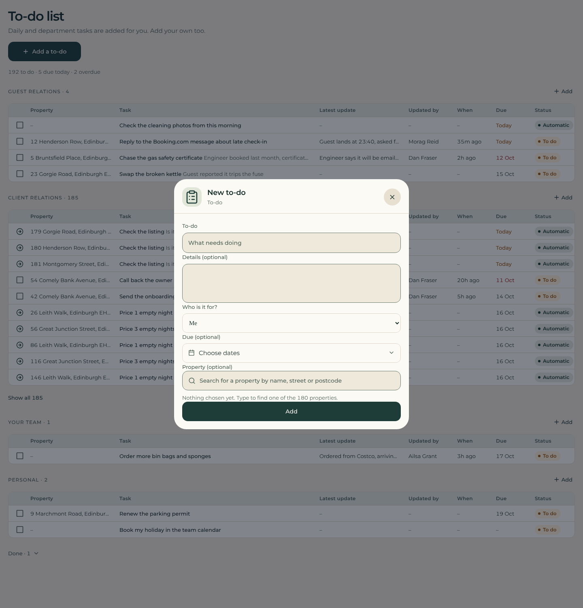 |

| Phone | Phone, detail |
| --- | --- |
| 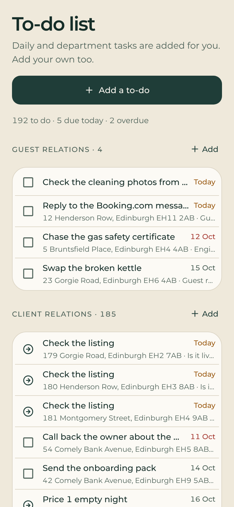 | 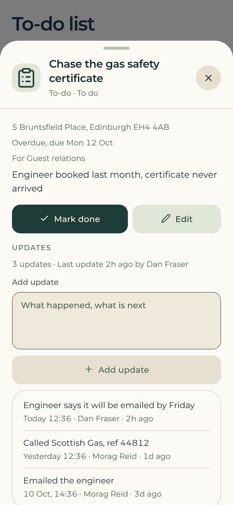 |

# Round 6, second task: Favorites always in the Overview (Lee)

Lee: "the favorites feature should always be in the overview for easy access regardless of which role we
have."

- **Menu (`lib/role-panel.ts`):** `page:favorites` is now in every role's first section, straight after
  Home, and is gone from More.
  - The first sections are: Overview for super admin, admin and Accounts; Today for Guest relations,
    Cleaning team and Ready; My day for Cleaners; Your properties for Owners.
  - The team-only limit on the Favorites page is removed, so owners get it too.
- **Search (`lib/workspace-search.ts`):** the Favorites page is in everyone's search list.
- **`LiveWorkspace.tsx`, so owners can use Favorites:**
  - the Favorites store loads for every role (still blank in a role preview);
  - the favorites context is given to every role, so the stars show for owners too;
  - the floating Favorites button on the phone shows for every role;
  - the "Save to Favorites" button on an open work item shows for every role;
  - the Favorites section is no longer limited to team roles.
- **Owners in the database: no migration was needed.** `workspace_favorites` and
  `workspace_save_favorites` accept any active role and only ever touch the caller's own row
  (`auth.uid()`).
- **Owners can only use what they can open:** a saved key is resolved against the person's own search
  list (`resolveFavorites`). A key the owner cannot open, for example a team page, is kept with its label
  so it can be removed, but it never opens. Owners can only pin from screens they already have.
- **Menu order (`lib/menu-layout.ts`):**
  - `LOCKED_LINKS = ['page:favorites']`.
  - The merge only places a locked link from its own section. Listed elsewhere, it goes back to its own
    section.
  - `moveItemTo` does nothing for it. It can still move up and down within its section, and it goes
    wherever its section goes.
- **Menu order editor (`MenuOrderEditor.tsx`):** no "Move to…" for Favorites. A lock icon and a note
  show: "Favorites stays in Overview for every role, so it is always easy to reach. It can move up or down
  here."
- **The phone:** the bar and the Menu are built from the same merged panel, so Favorites is either on the
  bar or first in the Menu (tested for all eight roles).
- **Tests:**
  - **New, `tests/favorites-overview.test.mjs`:** 6 of 6 pass. It covers all eight roles, a saved layout
    that cannot move Favorites out, the phone, owners' list resolving only what they can open, the
    editor's lock, and a database check that owners pin and unpin their own list and nobody else sees it.
  - **Tests outside my area that I changed,** because they said owners have no Favorites or that To-do
    comes straight after Home:
    - `tests/role-panel.test.mjs`: owners have Favorites; the team order is now Home, Favorites, To-do.
    - `tests/navigation-v2.test.mjs`: `page:favorites` removed from the owner's "never" list.
    - `tests/workspace-search.test.mjs`: owners have the Favorites page.
  - **My own round 5 tests:** `tests/menu-layout.test.mjs`, four expectations updated for Favorites in the
    first section. The "emptied section" case now empties Calendar & messages, because Today keeps the
    locked Favorites.
  - **Related tests:** app-wiring, business-workspace, favorites-database, header-actions,
    menu-layout-database, mobile-workspace, qa-wiring-fixes, role-authorization-matrix, search-and-cancel,
    view-as-database, view-as-http, wiring-fixes-v2, workspace-access and workspace-web-path all pass.
    wiring-v2 has only its known line-ending failure.

# Round 6, third task: delete client enquiries (Lee)

Lee: "we should be able to delete client enquiries." For example the test entry "Mark Raven Canete ·
Optimal · Tinibgan · Valuing".

## The screen (`LiveEnquiries.tsx`)

- **The button:** "Delete enquiry" in the enquiry's detail, for admins and super admins only
  (`canDeleteEnquiry` in `lib/client-enquiry.ts`).
- **When it shows:** only while the enquiry has not moved on. That means not yet answered, or its property
  is still at the enquiry stage, or it was archived by closing the enquiry.
- **Confirmation:** it asks first, in a sheet (no browser dialog): "Delete this enquiry? This removes the
  enquiry, its answers and photos, and the property it created. This can’t be undone." An enquiry that
  never made a property leaves out the part about the property.
- **Close** is unchanged.

## The database (`supabase/migrations/20261016210000_delete_client_enquiry.sql`, not applied)

- **New action `deleteEnquiry`** `{ requestId, enquiryId, version }`, routed from `workspace_teams_action`.
  - Admins and super admins only. Everyone else gets "Only management can delete an enquiry", including
    owners and Guest relations staff with onboarding.
  - It has a version check and action receipts.
- **Allowed only while it has not moved on.** All of these must hold:
  - the journey is at `enquiry`, or `archived` by Close;
  - no owner (journey `client_id`, or a client assignment);
  - no signed agreement and no invoice on the journey;
  - the property is still `onboarding` or `archived`;
  - nothing else refers to the property or the onboarding item.
- **How "nothing else refers to it" is checked:** `workspace_enquiry_moved_on` reads the foreign keys, so a
  table added later counts too. Stays, money, expenses, statements, to-dos, photos, flags, routine plans,
  guest messages and other work items all count.
  - The only references allowed are the ones the enquiry itself made: the journey, its questions, the
    onboarding item, the onboarding team's staff access, activity and notices, and the item's updates and
    upload intents.
  - Otherwise: "This enquiry has moved on. Close it instead."
- **What it deletes:**
  - the enquiry and its answers;
  - the property made on submit;
  - its journey and journey questions;
  - the onboarding work item, with its updates, details and upload intents;
  - the staff access to the property;
  - the property's and the item's activity and notices.

  Another enquiry marked as a duplicate of the property is kept, with the link cleared.
- **Files:** no removal queue existed before. The privacy erase and deleting a course both remove stored
  copies straight from the server. So I added `private.workspace_storage_removals` (bucket, path, reason,
  queued by, queued and removed times), with RLS on and no direct access.
  - The delete queues every photo and video path and returns the paths.
  - The server (`deleteEnquiry` in `lib/client-enquiry-server.ts`, routed in
    `lib/workspace-finance-server.ts`) removes the stored copies straight away. It then marks them removed
    with `workspace_storage_removed`, which only marks rows the caller queued.
  - If storage is down, the rows stay queued, on record.
- **History:** the access history gets a `client_enquiry.deleted` event with who and when (`actor_id`,
  `occurred_at`). It holds the enquiry id, name and company, status, stage, and whether a property was
  deleted. It holds no email, phone or address.
- **Run twice:** the table uses "if not exists", the functions are replaced, and the route patch has a
  sentinel and a single-line anchor.

## Tests

- **New, `tests/enquiry-delete-database.test.mjs`:** 9 of 9 pass. It covers:
  - the button rule and the wording;
  - deleting at each allowed stage: sent, opened, answered, valuing and closed, with nothing left behind
    (enquiry, property, journey, work, access, activity, notices);
  - the files queued and marked, only by whoever queued them;
  - the access history entry, without contact details;
  - refusal once moved on, with nothing deleted and nothing queued: an estimate, a linked owner, a
    signature, another to-do on the property, or an invoice;
  - every other role refused, a stale version, unknown keys and a repeated request;
  - a duplicate link cleared;
  - the screen and server wiring;
  - running the migration twice.
- **Existing tests still pass:** client-enquiries-database, enquiry-property-database, enquiry-property,
  enquiry-and-preview, hub-database, todo-updates-database, view-as-http, business-workspace and
  role-authorization-matrix (72 of 72, with the new file).

## For Lee

Once Lee or the Lead applies the migration, an admin can delete the test entry from the app.

# Round 6, merge with Session D's forms (Lead)

- **Merged:** `origin/claude/round6-forms-session-d`. The only conflict was `mobile/src/HubItemSheet.tsx`.
- **How it was resolved:** my form is kept: the Who-is-it-for dropdown pair, the `DateField` for "Due" and
  "Send by", and the search-only `PropertySelect`.
  - D's `ChoiceField` (department) is not used there, so its import is gone, along with `SearchPicker` and
    `Chip`.
  - There are no typed dates left: the old "Enter the date as YYYY-MM-DD." message now reads "Choose a valid
    date."
- **A test outside my area that I changed:** in `tests/choice-control.test.mjs`, the HubItemSheet row now
  expects my "Which department?" `Dropdown` in place of `ChoiceField`. It still checks there is no row of
  chips.
- **Left for D:** `tests/wiring-v2.test.mjs`, "the phone bar, management and the routine card use the new
  names", fails on D's branch as well. Its regex `<DailyTaskSettings p={p} account={account}[^>]*\/>` cannot
  get past the `=>` in D's `onShowAll={() => setDailyOnly(null)}`. Allowing `>` there (for example
  `[^]*?\/>`) would fix it.
- **Line endings:** `git add --renormalize .` staged nothing. The repository copy was already right; only
  the files on disk were LF. I converted them to CRLF in the working copy (no content change; `git status`
  is clean) and did not commit that. The 6 line-ending failures are gone.
- **For D:** `todoHubSchema` and `moveHubItem` are compatible with D's checklist.
  - The hub items gain `updateCount` and `updates`. Both have defaults.
  - `moveHubItem` takes the same input. A tick from the checklist now also logs "Marked done" (or
    "Reopened") in that to-do's update history.

# Round 6, Session E's design review: the items routed to Session B

- **Merged first:** `origin/claude/round6-uiux-session-e` (merge `edb7c13`), for E's tokens (`selected`,
  `onSelected`, `selectedBorder`, `washBorder`, `disabled`, `onSuccess`). Neither theme file was edited.
- **Not taken from D's branch:** D's `wiring-v2` regex fix. D force-pushed their branch, and the Lead keeps
  D's fix on the lead branch. Here that test still fails until the branches meet.

| # | What | Change |
| --- | --- | --- |
| 5 | The floating Favorites star covered content on phones ("Checklists" on Cleans). | Removed from `LiveWorkspace.tsx`, along with its 184 px bottom padding and its scroll-tuck timer. Favorites is in every role's first section, so on a phone it is on the bar or first in the Menu. |
| 6 | At 390 px the header buttons covered the logo ("R…ARGE"). | New `phoneHeader(width, has)` in `lib/header-actions.ts`, from the real sizes (46 px buttons, 44 px avatar, 8 px gaps, 40 px padding, 12 px before the buttons). Menu, the bell, Messages and the avatar always show. Search, View as, Refresh and the dark-mode switch show only while the logo keeps 88 px; otherwise they move to the top of the Menu sheet. Under 346 px the logo shrinks to the room left, so nothing ever sits on it. The old count left out Menu and Messages. |
| 7 | To-do as tall cards. | Already covered: E's screenshot came from `main`, before my thin rows (`cb4d767`). The after shot shows the rows. |
| 8 | "New property enquiry" was a full-width mint block in dark mode (`EnquiryCard` in `HomeOverview.tsx`). | Now a surface card with a hairline, a wash icon tile edged with `washBorder`, text and muted lines, and one primary "Add" pill. Owners see the same card ("Have another property?"). |
| 10 | The department strip and Work tabs on phones showed the chosen tab as a mint block. | The shared `FilterBar` now uses `selected`, `selectedBorder` and `onSelected` (deep green with a mint edge in dark, forest in light). It also serves LiveHub, WorkspaceScreens and AccessHelp. |
| 12 | Hard-coded white and white-alpha in `RoleNavigation`, `LiveProductivity` and `LiveEnquiries`. | Changed to tokens: text is `heroText`; secondary lines are `heroMuted` with an opacity; icons are `heroLine` or `heroGlow`; the white pill is `heroText` with `hero` text. See-through tiles and edges use a new `HeroWash.tsx`, which layers `heroText` at a low opacity, because on the web a token is a CSS variable and can't take an alpha suffix. The web-only inset highlight in the role panel is `p.surface`. |

**Side fix:** with the star's timer gone, the React Compiler analysed further into `LiveWorkspace` and ESLint
reported an older issue in `loadReport`, whose `useCallback` was missing `setSnapshot`. I added it; a state
setter never changes, so behaviour is the same. The unused `web` import in `LiveEnquiries.tsx` is removed.

## Tests

- **New, `tests/e-review-fixes.test.mjs`:** 7 of 7 pass. It covers:
  - the 390 px header for a super admin and for an owner;
  - every width from 320 to 1,022 px: the row fits beside the logo, the logo keeps 88 px from 346 px up,
    wider phones never get fewer buttons, and each button is either in the header or in the Menu;
  - the workspace wiring and the Menu list;
  - no star;
  - the enquiry card, the strip's tokens, and no hard-coded white or brand colour in the three files.
- **Changed:** `tests/favorites-overview.test.mjs` now checks the star is gone.

## Screenshots

- **Where:** `docs/screenshots/session-b/e-review/`, phone (390×844) in dark mode, before and after.
- **How they were taken:**
  - **App and data:** the local review server (`scripts/demo/server.mjs`) with its seeded sample business,
    signed in as each role through `/dev/as/<role>`.
  - **Builds:** before is `edb7c13` (`main` plus round 6, before these fixes); after is this commit.
  - **Shots:** home header (super admin, Guest relations, owner), cleaner home and Work, the Work strip,
    Properties, To-do, Client enquiries, and the Menu after (where the moved header buttons are).
- **Missing before shot:** there is no before shot of the Menu; its server had been stopped.
